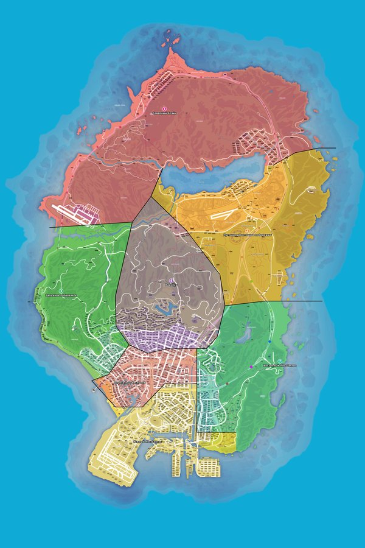
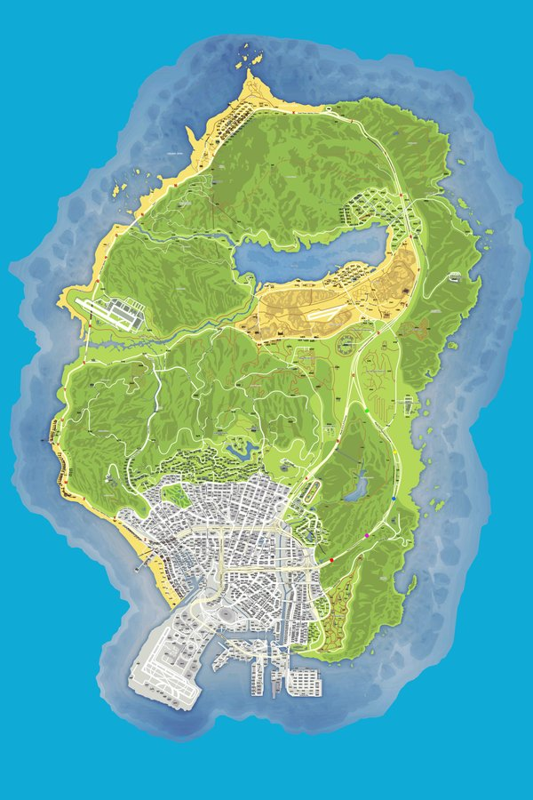

<p align="center"></p>

# Карта избирательных округов для FiveM

Модификация заменяет оформление игровой карты на версию с цветовым выделением семи избирательных округов, их названиями и границами. Области округов выделены согласно текущей политической ситуации проекта; при изменениях в игре границы карты могут потребовать обновления.

> **Важно:** нумерация домов на карте **не соответствует GPS-меткам проекта**. Не используйте её как точный аналог проектной GPS-нумерации.

## Скачать

[](https://raw.githubusercontent.com/Ven4esters/gta5-custom-map/main/mods/gta5-custom-map.rpf)

Кнопка скачивает файл `gta5-custom-map.rpf`. Также можно [открыть папку mods](https://github.com/Ven4esters/gta5-custom-map/tree/main/mods) или скачать репозиторий целиком: **Code → Download ZIP**.

## Демонстрация

Изображения ниже — уменьшенные копии. По нажатию откроются оригиналы в полном размере.

### С округами

[](https://github.com/Ven4esters/gta5-custom-map/blob/main/full_map/gta5_sea_regions_full.png)

### Исходная карта без выделения округов

[](https://github.com/Ven4esters/gta5-custom-map/blob/main/full_map/gta5_map_original.png)

Это исходная карта мода до нанесения округов, а не обязательно стандартная карта базовой GTA V.

## Установка в FiveM на Windows

1. Закройте FiveM.
2. Скачайте репозиторий через **Code → Download ZIP** и распакуйте архив. В нём находится папка `mods` с файлом `gta5-custom-map.rpf`.
3. Откройте папку данных FiveM одним из способов ниже.
4. Скопируйте папку `mods` из архива в папку `FiveM Application Data`. Если `mods` уже существует, объедините папки, сохранив другие модификации. При запросе замены файлов сначала сделайте резервную копию.
5. Запустите FiveM и проверьте карту. Результат может зависеть от настроек сервера, версии клиента и других модификаций.

В итоге путь к файлу должен выглядеть так:

```text
%localappdata%\FiveM\FiveM Application Data\mods\gta5-custom-map.rpf
```

**Открыть папку через Win + R:** нажмите `Win + R`, вставьте и нажмите Enter:

```text
%localappdata%\FiveM\FiveM Application Data
```

**Через Проводник:** вставьте тот же путь в адресную строку Проводника и нажмите Enter.

**Вручную:** откройте `C:\Users\ВАШЕ_ИМЯ\AppData\Local\FiveM\FiveM Application Data`. Папка `AppData` может быть скрыта; буква диска и имя пользователя зависят от установки.

**Через ярлык FiveM:** щёлкните правой кнопкой по ярлыку → **Расположение файла**; в открывшемся каталоге найдите `FiveM Application Data`. Если открылось другое расположение, используйте путь через `%localappdata%`.

Если скачан только `.rpf` по кнопке, поместите его в папку `mods` по указанному пути; если папки `mods` нет, создайте её.

## Удаление и решение проблем

Закройте FiveM и удалите только `mods\gta5-custom-map.rpf`, затем верните резервные копии, если заменяли другие файлы. Не удаляйте всю папку `mods`, если в ней есть другие модификации.

Если карта не меняется, проверьте расположение файла, наличие других модов карты и правила сервера. Не гарантируется совместимость со всеми серверами и версиями клиента; при ограничениях или серверной замене карты локальная модификация может не применяться.

## Запрос на кастомную карту

В теме на форуме можно попросить карту с другими выделенными территориями. Прикрепите базовую карту, **обведите нужные территории в любом графическом редакторе** и подпишите названия, цвета и особенности границ. Также можно предложить другое изображение карты для адаптации под текущие реалии проекта или другой сценарий; возможность и сроки такой работы обсуждаются в теме.

## Источник и благодарности

Исходная карта взята из темы [LEO Map Blocks](https://forum.ls-project.com/index.php?/topic/267-leo-map-blocks/), опубликованной [Suvorov](https://forum.ls-project.com/index.php?/profile/218-suvorov/). На её основе выполнена доработка с выделением округов. Доступ к теме-источнику может требовать авторизации на форуме.
